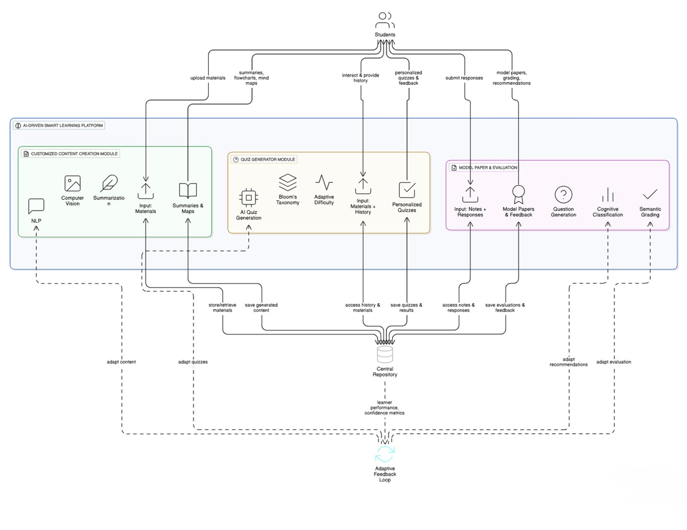
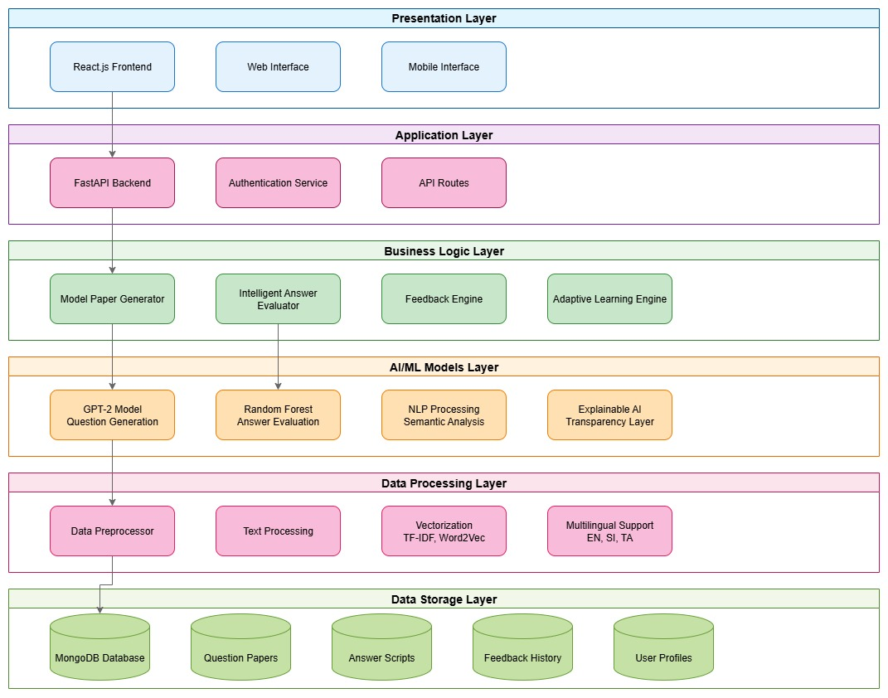

# Adaptive and cognitive-based smart learning system

## Important Information

* `Project Name` - Adaptive and cognitive-based smart learning system
* `Group ID` - 25-26J-536
* `Research Area` - CoEAI - Centre of Excellence for AI

### Technologies
* `Python Version` - 3.10.14
* `Tensorflow Version` - 2.10.1
* `anaconda Version` - 4.10.3

### Environment Setup
* `Anaconda` - [Download Anaconda](https://www.anaconda.com/products/distribution)

    * `Create Environment` - `conda create --n env_name python=3.9`
    * `Activate Environment` - `conda activate env_name`
    * `Deactivate Environment` - `conda deactivate`
    * `Install NumPy` - `conda install "numpy<2"`
    * `Install TensorFlow` - `python -m pip install "tensorflow<2.11"`
    * `Install Matplotlib` - `conda install matplotlib`
    * `Install Scikit-learn` - `conda install scikit-learn`
    * `Install Pandas` - `conda install pandas`
    * `Cuda Toolkit` - `conda install -c conda-forge cudatoolkit=11.2 cudnn=8.1.0`
 
 ## Supervisors
|  | Title | Name |
|---| -- | --- |
| Supervisor | Prof | Pradeep Abeygunawardhana |
| Co-Supervisor | Ms | Suranjini Silva |

## Group Members
| Student ID | Student Name | Student Email |
|--|---|---|
| IT22607096 | R.M.D.L. Rajapaksha | it22607096@my.sliit.lk |
| IT21245060 | H.P.S.P. Weerakoon | it21245060@my.sliit.lk |
| IT22581716 | M.M.D. Perera | it22581716@my.sliit.lk |

## Adaptive and Cognitive-Based Smart Learning System

An intelligent learning platform that adapts to how students engage with study materials using artificial intelligence (AI). The system provides a personalized learning experience through three modular units:

- **Customized Content Creation**
- **Quiz Generator**
- **Model Paper Generation with Intelligent Answer Evaluation**

---

## 🎯 Overview

The solution addresses fundamental problems in post-secondary education including the absence of individual support, self-study resources, personal feedback, and non-adaptive assessments. It ensures adaptivity, constant feedback, and cognitive reinforcement.

---

## 📚 Modules

### 1. Customized Content Creation

The system accepts various educational inputs in multiple formats:

- **Input Types:** Lecture slides, notes, past papers
- **Supported Formats:** PDF, images, text

**Features:**
- Natural Language Processing (NLP) for text analysis
- Computer vision for image processing
- Summarization algorithms for content simplification
- Converts complex content into learner-friendly outputs:
  - Summaries
  - Mind maps
  - Flowcharts

This module accommodates various learning styles and simplifies complex material.

### 2. Quiz Generator

Dynamically generates custom quizzes from uploaded materials.

**Features:**
- **Adaptive Learning:** Creates iterative quiz sets focusing on concepts the student answered incorrectly
- **Multiple Question Types:**
  - Multiple Choice Questions (MCQ)
  - Open-ended questions
  - True/False questions
- **Formative Feedback:** Provides immediate feedback to facilitate cognitive recall and retention
- **Performance-Based Customization:** Adjusts difficulty based on student performance

### 3. Model Paper Generation & Intelligent Answer Evaluation

Generates complete model question papers aligned with subject layouts.

**Features:**
- Full-length model paper generation
- AI-powered answer grading using semantic similarity
- Detailed feedback on weak areas
- Specific resource recommendations for improvement
- Support for various question types and marking schemes

---

## 🏗️ Architecture

The modular architecture allows each component to work both independently and synergistically, providing a non-linear yet cohesive smart learning experience.

### System Overview



### Component Diagram



---

## 🛠️ Tech Stack

### Backend
- **Framework:** FastAPI (Python)
- **AI/ML:** Google Gemini AI, LoRA fine-tuned models
- **NLP:** Natural Language Processing for content analysis
- **Document Processing:** PDF extraction, OCR

### Frontend
- **Framework:** React with TypeScript
- **Styling:** Tailwind CSS
- **Build Tool:** Vite

---

## 🚀 Getting Started

### Prerequisites
- Python 3.10+
- Node.js 18+
- Google Gemini API key

### Backend Setup

```bash
cd backend
python -m venv .venv
.venv\Scripts\Activate.ps1  # Windows
# source .venv/bin/activate  # Linux/Mac
pip install -r requirements.txt
uvicorn main:app --reload
```

### Frontend Setup

```bash
cd frontend
npm install
npm run dev
```

---

## 📁 Project Structure

```
model_paper_generator/
├── backend/
│   ├── controllers/      # Request handlers
│   ├── routes/           # API endpoints
│   ├── schemas/          # Pydantic models
│   ├── utils/            # AI services, PDF extraction
│   └── main.py           # FastAPI application
├── frontend/
│   ├── src/
│   │   ├── api/          # API client
│   │   ├── components/   # Reusable UI components
│   │   ├── pages/        # Page components
│   │   └── types/        # TypeScript types
│   └── package.json
├── data/                 # Extracted lecture content
├── models/               # LoRA fine-tuned models
└── notebooks/            # Training & analysis notebooks
```

---

## 🎓 Supported Subjects

- Deep Learning (SE4050)
- Data Analytics (SE4040)
- Innovation & Entrepreneurship (SE4030)
